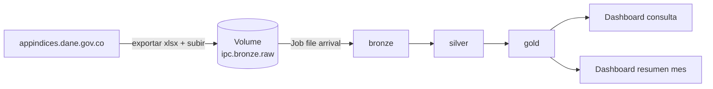

# IPC Colombia en Databricks

Proyecto para **aprender Databricks** con datos reales: el Índice de Precios al Consumidor (IPC)
base 2018 del DANE, completamente desagregado por **ciudad**, **nivel de ingreso** y **división /
grupo / clase / subclase de gasto**.

## Objetivos
1. Consolidar la serie histórica del IPC desde 2018 en tablas Delta (Unity Catalog).
2. Actualizarla cada mes con la nueva publicación del DANE.
3. Un **tablero de consulta** con gráficas y tablas filtrables por división de gasto, ingreso,
   ciudad, mes y año.
4. Un **tablero resumen del último mes**: lo que más cambió y cómo se movieron las brechas.

## Arquitectura



- **Plataforma**: Databricks Free Edition (serverless, Unity Catalog, Lakeflow Jobs, AI/BI Dashboards).
- **Fuente**: [Consulta dinámica IPC base 2018](https://appindices.dane.gov.co/) (DANE). Es un
  reporte de Power BI sin API, así que la exportación mensual es manual; el resto es automático.

## Empezar
👉 Sigue la guía paso a paso en **[docs/00_indice.md](docs/00_indice.md)**.

## Estructura

```
docs/         Guía paso a paso (en español)
notebooks/    Notebooks de Databricks (formato .py)
src/ipc/      Código Python reutilizable (configuración, funciones)
tests/        Pruebas con pytest
databricks.yml  Asset Bundle (despliegue como código)
```

## Entorno local

```bash
uv sync
uv run pytest
```

## Estado
- [x] Etapa 1: repo, entorno, guía de arranque, setup de catálogo
- [ ] Etapa 2: pipeline bronze → silver → gold
- [ ] Etapa 3: job mensual
- [ ] Etapa 4: tableros

Datos: © DANE. Este repositorio no redistribuye archivos de datos.
