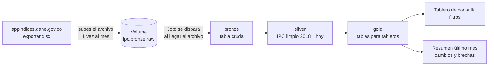

# Guía paso a paso: IPC Colombia en Databricks

Esta guía parte de cero: no necesitas saber nada de Databricks ni tener cuenta.
Sigue los pasos en orden; cada uno termina con un **✅ Checkpoint** para saber que vas bien.

| Paso | Qué haces | Tiempo aprox. |
|---|---|---|
| [01 · Crear cuenta Free Edition](01_crear_cuenta_free_edition.md) | Registro y tour por la interfaz | 15 min |
| [02 · Conceptos clave](02_conceptos_clave.md) | Lo mínimo que hay que entender (lectura) | 15 min |
| [03 · Conectar GitHub](03_conectar_github.md) | Traer este repo al workspace | 10 min |
| [04 · Entorno local (opcional)](04_cli_y_entorno_local.md) | Editar en VS Code y sincronizar con Git | 10 min |
| [05 · Catálogo y volumen](05_crear_catalogo_y_volume.md) | Correr tu primer notebook | 10 min |
| [06 · Exportar desde appindices](06_exportar_desde_appindices.md) | Bajar el IPC y subirlo a Databricks | 20 min |
| [07 · Hoja de ruta](07_hoja_de_ruta.md) | Lo que construiremos después | lectura |
| [08 · Metodología y ponderadores](08_metodologia_ponderadores.md) | Cómo se agregan subclases, ciudades e ingresos | lectura |

## Cómo funciona el proyecto (resumen)

La única parte manual es exportar el archivo del DANE, porque el sitio es un reporte de Power BI
que no tiene una API de descarga (ver detalles en el paso 06). Databricks hace todo lo demás.
