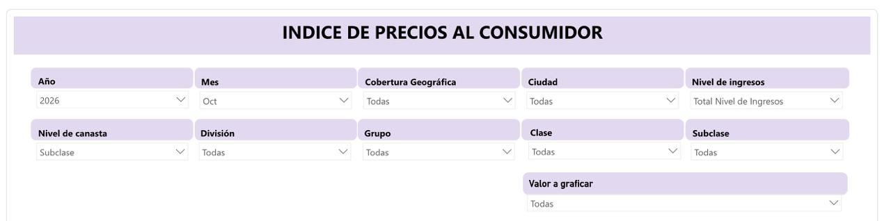

# 06 · Exportar el IPC desde appindices y subirlo a Databricks

## Por qué este paso es manual

<https://appindices.dane.gov.co/> es un **reporte de Power BI embebido**: los datos se ven en
pantalla y se exportan con un botón, pero no hay una API ni enlaces directos a archivos. Además,
el cómputo de Databricks Free Edition solo puede salir a internet hacia algunos dominios de
confianza y no tiene navegador. Por eso:

- **Tú**: exportas el archivo y lo subes al volumen.
- **Databricks**: detecta el archivo nuevo y hace todo lo demás (etapa 2).

Guía oficial del DANE: <https://appindices.dane.gov.co/resources/pdf/guia_de_usuario.pdf>

## El query mensual

| Filtro | Selección |
|---|---|
| Año / Mes | El mes nuevo (p. ej. 2026 / Oct) |
| Cobertura geográfica | Todas |
| Ciudad | Todas |
| Nivel de ingresos | **Uno a la vez** (ver límite abajo) |
| Nivel de canasta | Subclase |
| División / Grupo / Clase / Subclase | Todas |
| Valor a graficar | Ver recomendación abajo |

Luego, sobre la tabla: menú **⋯** → **Exportar datos** → **.xlsx**.

## Lo que trae el archivo (revisado con un ejemplo real)

- Hoja `Export`. Dos filas de encabezado: nombres de medidas y nombres de dimensiones.
- Columnas: Año, Mes, Nivel de ingresos, Nivel de canasta, División, Grupo, Clase, Subclase
  (como `01110100 - Arroz`: código + nombre), Cobertura Geografica (ciudad) y 15 medidas:
  Número Índice y Variación / Contribución / Participación (mensual, año corrido, anual,
  trimestral, semestral).
- Los números vienen como texto con coma decimal (`155,06`). Hay celdas vacías (no publicadas).
- **14 geografías**: Nacional + 13 ciudades (Barranquilla, Bogotá, Bucaramanga, Cali, Cartagena,
  Cúcuta, Manizales, Medellín, Montería, Neiva, Pasto, Pereira, Villavicencio). San Andrés y
  Quibdó vienen excluidas por el reporte.
- ~188 subclases por ciudad → **~2.630 filas por mes** por cada nivel de ingresos.
- Al final: "Filtros aplicados: ..." (útil como auditoría).

El lector [src/ipc/lector.py](../src/ipc/lector.py) ya entiende este formato.

## ⚠️ Límites de exportación (probados)

Power BI exporta en dos formatos y el lector entiende ambos:

| Formato | Cómo se ve | Límite | Aviso al final/inicio |
|---|---|---|---|
| Ancho (una columna por medida) | `data.xlsx` de ejemplo | ~9.400 filas | `Exported data exceeded the allowed volume` |
| **Largo** (una fila por medida) | columnas `Medida` y `Medida_Dinamica` | **150.000 filas** | `Exported data limited to 150000 rows` |

El lector **rechaza** archivos con cualquiera de esos avisos, así que no se cuelan datos
incompletos.

En formato largo, cada mes y nivel de ingresos ocupa **4.512 filas por medida** (188 subclases ×
24 geografías; las 10 ciudades pequeñas y "Otras áreas urbanas" salen vacías a nivel de subclase,
pero igual cuentan para el límite). Con las 16 medidas son 72.000 filas por mes, así que un año
no cabe.

**Recomendación: exportar solo `Número Índice`.** Las variaciones (mensual, anual, año corrido…)
se calculan a partir del índice, y las contribuciones se calculan con los ponderadores. Así:

| Exportación | Filtros | Filas aprox. | Archivos |
|---|---|---|---|
| Histórico | 1 año · 1 nivel de ingresos · niveles de canasta Total+División+Grupo+Clase+Subclase · Valor = Número Índice | ~94.000 | 1 por año por nivel de ingresos (8 años × 5 = 40) |
| Mensual | 1 mes · **todos** los niveles de ingresos · todos los niveles de canasta · Número Índice | ~39.000 | 1 por mes |

Prioridad para el histórico: primero **Total Nivel de Ingresos** (2019 → hoy); después los demás
niveles de ingresos, que son los que permiten analizar las brechas.

## Nombres de archivo (convención)

`ipc_<nivel>_<año>_<mesinicial>-<mesfinal>.xlsx`, con nivel en `total`, `altos`, `media`,
`vulnerables`, `pobres`:

- Histórico: `historico/ipc_total_2019_01-03.xlsx`
- Mensual: `mensual/ipc_total_2026_10.xlsx`, `mensual/ipc_pobres_2026_10.xlsx`

El nombre es solo para que tú te orientes: el proceso lee año, mes e ingreso del contenido del
archivo y elimina duplicados si un mes llega dos veces.

## Dónde guardar los archivos

| En tu computador (no se sube a GitHub) | En Databricks |
|---|---|
| `data/historico/` | `/Volumes/ipc/bronze/raw/historico/` |
| `data/mensual/` | `/Volumes/ipc/bronze/raw/mensual/` |

**Subir**: **Catalog** → `ipc` → `bronze` → **Volumes** → `raw` → entra a la carpeta →
**Upload to this volume** → arrastra uno o varios archivos a la vez.

## Ponderadores (archivos de referencia)

En [referencia/](../referencia/) están los ponderadores oficiales del IPC base 2018 (página
[IPC ponderadores](https://www.dane.gov.co/index.php/estadisticas-por-tema/precios-y-costos/indice-de-precios-al-consumidor-ipc/ipc-actualizacion-metodologica-2019/ipc-ponderadores)
del DANE), con los códigos de la jerarquía:

- `ponderadores_subclase.csv`: 188 subclases × Pobres, Vulnerables, Clase Media, Altos, Total
- `ponderadores_division.csv`: 12 divisiones
- `ponderadores_ciudad.csv`: peso de 23 ciudades en el total nacional

Súbelos a una carpeta `referencia/` dentro del volumen `raw` (créala con **Create directory**).

## Explorar el primer archivo

Abre [notebooks/01_explorar_archivo.py](../notebooks/01_explorar_archivo.py) en Databricks y dale
**Run all** para confirmar que Databricks lee el archivo.

## ✅ Checkpoint
Hay archivos en `/Volumes/ipc/bronze/raw/` y el notebook 01 muestra su resumen.
