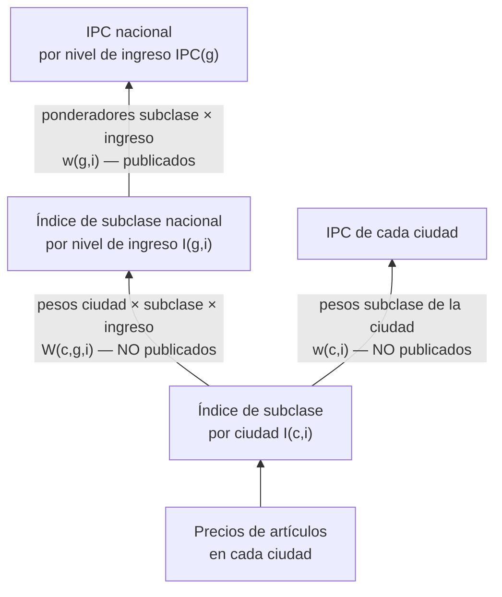

# 08 · Cómo se agrega el IPC: subclases, ciudades y niveles de ingreso

Notas de trabajo, comprobadas con los datos de octubre de 2026.

## La pirámide de agregación del DANE



La fórmula en cada nivel es un promedio ponderado (tipo Laspeyres) de índices con base
dic-2018 = 100:

```
Índice agregado(t) = Σ peso_i × Índice_i(t) / Σ peso_i
```

## 1. De subclases a total nacional ✅ (reproducido)

Con los índices nacionales de subclase y los ponderadores `w(g,i)` de
[referencia/ponderadores_subclase.csv](../referencia/ponderadores_subclase.csv):

| Oct-2026 | Calculado | Publicado |
|---|---|---|
| Total ingresos: índice | 161,30 | 161,32 |
| Total ingresos: var. mensual | 0,20 % | 0,20 % |
| Total ingresos: var. anual | 6,31 % | 6,30 % |

Con los anexos `anex-IPC-subclases-ingresos-*` (índices de subclase y pesos de cada nivel de
ingreso):

| Oct-2026 | Pobres | Vulnerables | Clase media | Altos | Total |
|---|---|---|---|---|---|
| Índice | 164,94 | 165,33 | 161,85 | 157,33 | 161,30 |
| Var. mensual | 0,30 % | 0,25 % | 0,21 % | 0,12 % | 0,20 % |

(Falta comparar estos valores por nivel de ingreso con una cifra publicada.)

**Importante:** el índice de una misma subclase es distinto en cada nivel de ingreso (arroz
oct-2026: Pobres 155,20 y Total 155,06). Por eso, para calcular un nivel de ingreso no se puede
cambiar solo el ponderador: hay que usar también los índices de subclase de ese nivel.

## 2. De ciudades a nacional ⚠️ (solo aproximado)

El índice nacional de cada subclase es un promedio de las ciudades, pero con un peso distinto por
ciudad **para cada subclase** (y para cada nivel de ingreso). El DANE solo publica el peso total de
cada ciudad ([referencia/ponderadores_ciudad.csv](../referencia/ponderadores_ciudad.csv); Bogotá
40,45 %).

Prueba con las 13 ciudades exportadas (88,7 % del peso) y pesos de ciudad fijos:

- Por subclase el error es grande: mediana de 1,1 puntos y hasta 21 puntos en algunos alimentos.
- En el total nacional los errores se compensan: 161,29 frente a 161,32.

Además, 10 ciudades y "Otras áreas urbanas" no tienen datos publicados por subclase. Conclusión:
**el nacional no se reconstruye desde las ciudades**. Se usan los índices nacionales que publica
el DANE.

## 3. ¿Niveles de ingreso dentro de una ciudad?

Haría falta `w(c,g,i)`, el peso de cada subclase para cada ingreso en cada ciudad, y no está
publicado. Usar los ponderadores nacionales por ingreso en una ciudad da solo una **aproximación**,
porque la canasta cambia entre ciudades (p. ej. el peso del transporte o del arriendo).

Si appindices publica directamente la combinación ciudad × nivel de ingreso, conviene exportarla
en vez de calcularla.

## Qué usaremos en el proyecto

| Necesidad | Fuente |
|---|---|
| Índices de subclase (nacional y ciudades, por ingreso) | Exportaciones de appindices |
| Totales, divisiones, grupos y clases nacionales por ingreso | Cálculo con `w(g,i)` y validación contra lo publicado |
| Totales por ciudad (y por ciudad × ingreso, si existe) | Exportar de appindices (niveles de canasta agregados) |
| Contribuciones de cada subclase al cambio nacional | Cálculo con `w(g,i)` |
| Brechas entre niveles de ingreso | Diferencia entre las variaciones de cada nivel de ingreso |
