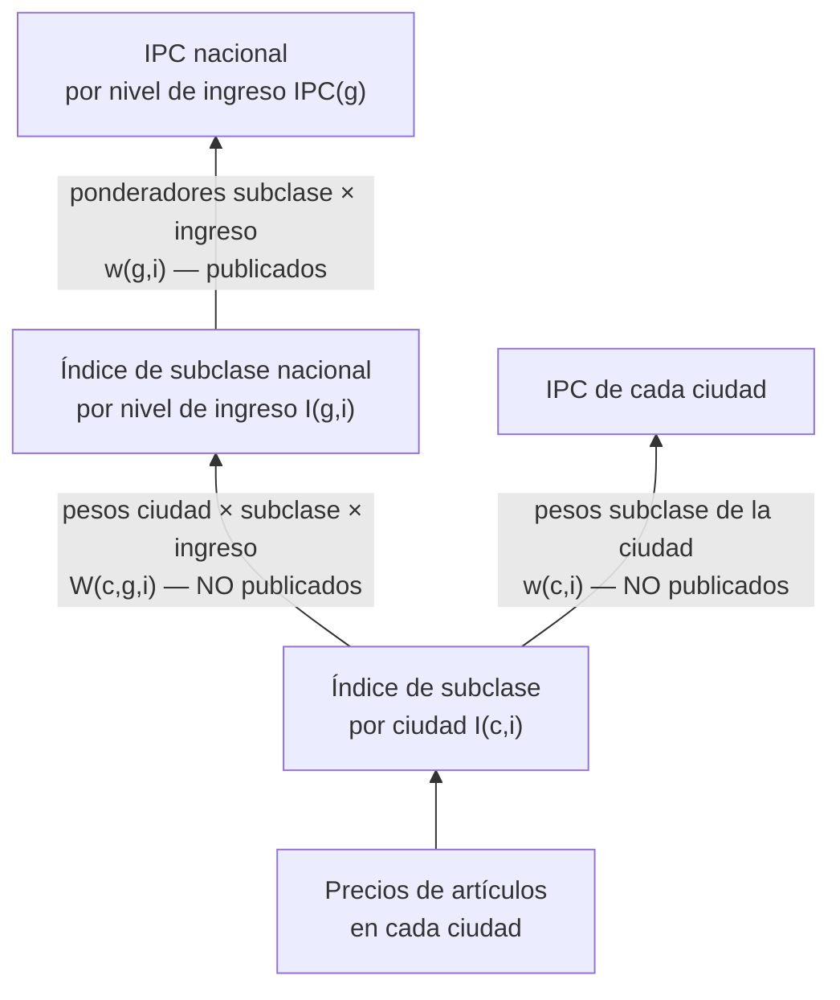

# 08 · Cómo se agrega el IPC: subclases, ciudades y niveles de ingreso

Notas de trabajo, comprobadas con los datos de octubre de 2026.

## La pirámide de agregación del DANE



La fórmula en cada nivel es un promedio ponderado (tipo Laspeyres) de índices con base
dic-2018 = 100:

```
Índice agregado(t) = Σ peso_i × Índice_i(t) / Σ peso_i
```

## 1. De subclases a total nacional ✅ (reproducido)

Con los índices nacionales de subclase y los ponderadores `w(g,i)` de
[referencia/ponderadores_subclase.csv](../referencia/ponderadores_subclase.csv):

| Oct-2026 | Calculado | Publicado |
|---|---|---|
| Total ingresos: índice | 161,30 | 161,32 |
| Total ingresos: var. mensual | 0,20 % | 0,20 % |
| Total ingresos: var. anual | 6,31 % | 6,30 % |

Con los anexos `anex-IPC-subclases-ingresos-*` (índices de subclase y pesos de cada nivel de
ingreso):

| Oct-2026 | Pobres | Vulnerables | Clase media | Altos | Total |
|---|---|---|---|---|---|
| Índice | 164,94 | 165,33 | 161,85 | 157,33 | 161,30 |
| Var. mensual | 0,30 % | 0,25 % | 0,21 % | 0,12 % | 0,20 % |

Validado contra appindices: el IPC nacional de Pobres en oct-2026 es **164,92** publicado frente a
164,94 calculado.

**Importante:** el índice nacional de una misma subclase es distinto en cada nivel de ingreso
(arroz oct-2026: Pobres 155,20, Vulnerables 154,33, Clase media 155,44, Altos 155,19, Total
155,06). Solo 4 de las 188 subclases tienen el mismo índice en los 5 niveles. Por eso, para
calcular un nivel de ingreso no basta con cambiar el ponderador: hay que usar también los índices
de subclase de ese nivel.

**¿Por qué pasa?** Hay dos fuentes de diferencia.

**a) Dentro de cada ciudad, por los artículos.** Una subclase agrupa artículos (Frutas frescas
incluye muchas frutas; Pastas incluye "para sopa" y "para seco"), y cada nivel de ingreso los
pondera distinto. Comparación de Pobres contra Total en las 13 ciudades (oct-2026,
`pobres_2026.xlsx` frente a `data.xlsx`):

| Artículos en la subclase | Pares ciudad × subclase con índice idéntico |
|---|---|
| 1 artículo (p. ej. Arroz, Aguardiente) | 91 % |
| 2-3 artículos | 19 % |
| 4 o más artículos | 1 % |

Las excepciones de un solo artículo son tarifas que dependen del estrato (agua, alcantarillado,
aseo, electricidad), el arriendo imputado y algunos servicios. Ni los pesos de los artículos ni sus
precios están publicados, así que **el índice de subclase de cada ciudad y cada nivel de ingreso
hay que exportarlo**: no se puede derivar del Total.

**b) Al pasar a nacional, por las ciudades.** Cada ciudad pesa distinto según el nivel de
ingreso. Evidencia (oct-2026, 13 ciudades exportadas):

- En el 99-100 % de las subclases, el índice nacional de cada nivel de ingreso cae dentro del
  rango de los índices de las ciudades. Es lo esperable si es un promedio de ciudades.
- La brecha Pobres–Altos de una subclase crece cuanto más difieren las ciudades entre sí
  (correlación 0,57). Mediana de la brecha: 1,6 puntos en las subclases donde las ciudades se
  parecen y 9,6 puntos donde difieren más.

## 2. De ciudades a nacional ⚠️ (solo aproximado)

El índice nacional de cada subclase es un promedio de las ciudades, pero con un peso distinto por
ciudad **para cada subclase** (y para cada nivel de ingreso). El DANE solo publica el peso total de
cada ciudad ([referencia/ponderadores_ciudad.csv](../referencia/ponderadores_ciudad.csv); Bogotá
40,45 %).

Prueba con las 13 ciudades exportadas (88,7 % del peso) y pesos de ciudad fijos:

- Por subclase el error es grande: mediana de 1,1 puntos y hasta 21 puntos en algunos alimentos.
- En el total nacional los errores se compensan: 161,29 frente a 161,32.

Además, 10 ciudades y "Otras áreas urbanas" no tienen datos publicados por subclase. Conclusión:
**el nacional no se reconstruye desde las ciudades**. Se usan los índices nacionales que publica
el DANE.

## 3. ¿Niveles de ingreso dentro de una ciudad?

**Sí, appindices los publica.** Con Nivel de ingresos = Pobres y Nivel de canasta = Total trae el
IPC de Pobres para el nacional y las 13 ciudades (oct-2026: Cúcuta 175,75; Bogotá 162,59;
Villavicencio 159,69…). No hay que estimar nada: se exporta.

Calcularlo con los ponderadores nacionales no sería correcto por dos razones: la canasta de cada
ciudad pesa distinto y, como se vio arriba, los índices de subclase de la ciudad también cambian
según el nivel de ingreso.

## Qué usaremos en el proyecto

| Necesidad | Fuente |
|---|---|
| Índices de subclase (nacional y ciudades, por ingreso) | Exportaciones de appindices |
| Totales, divisiones, grupos y clases nacionales por ingreso | Cálculo con `w(g,i)` y validación contra lo publicado |
| Totales por ciudad y por ciudad × ingreso | Exportar de appindices (nivel de canasta Total y demás niveles agregados, un archivo por nivel de ingreso) |
| Contribuciones de cada subclase al cambio nacional | Cálculo con `w(g,i)` |
| Brechas entre niveles de ingreso | Diferencia entre las variaciones de cada nivel de ingreso |
